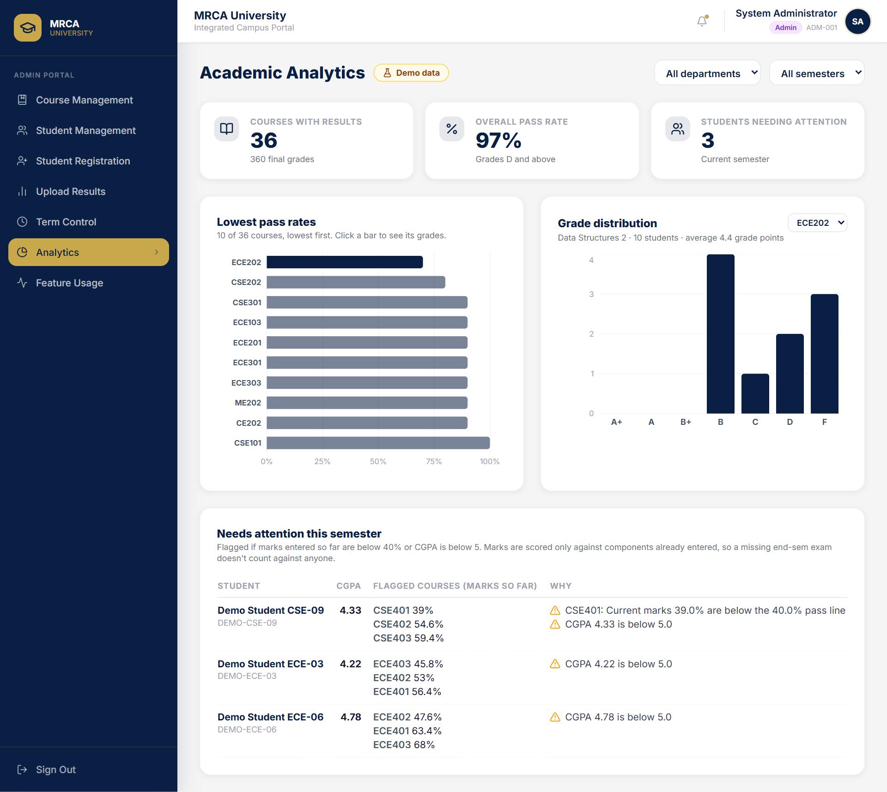
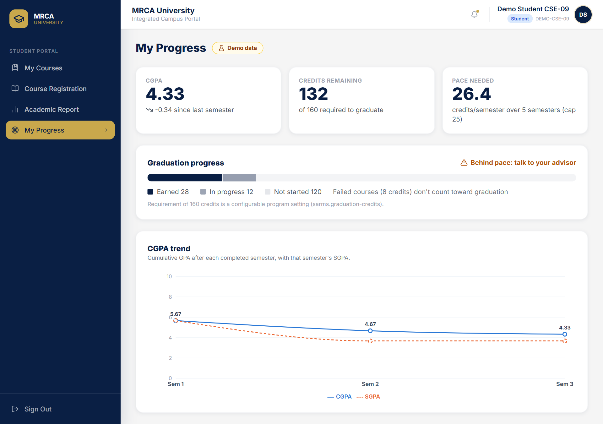
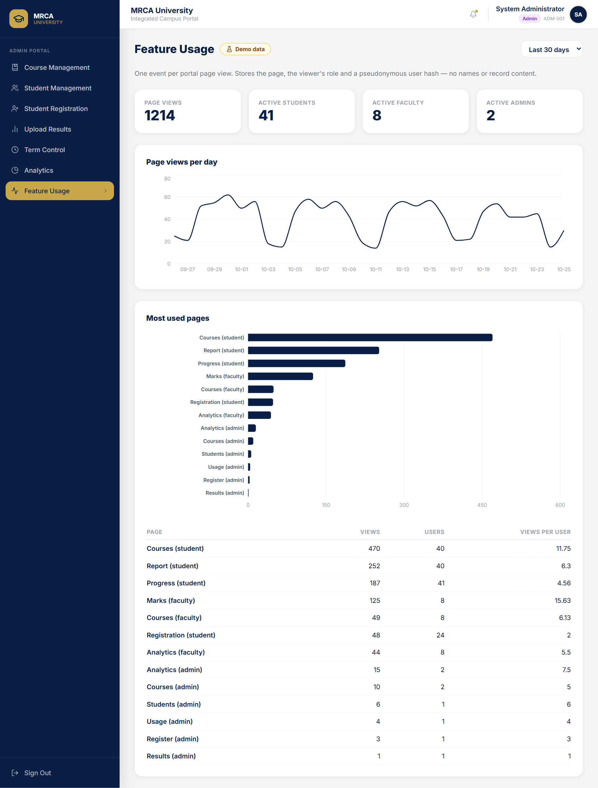

<div align="center">

<br/>


<br/><br/>

# SARMS

### Student Academic Records Management System

*A university records system that stores grades well, extended so that students, faculty and admins can act on them earlier.*

</div>

> **Credit.** SARMS began as a four-person team project at [top-of-the-code/SARMS](https://github.com/top-of-the-code/SARMS). Everything up to commit `ef77690` is shared team work. This fork is maintained by Aryan Rastogi, and **everything after that commit is my solo work**. The [CHANGELOG](CHANGELOG.md) separates the two line by line, and every feature below is labelled **Team** or **Solo**.

---

## Contents

- [The problem](#the-problem)
- [Who it's for](#who-its-for)
- [Features](#features)
- [Product documents](#product-documents)
- [Tech stack](#tech-stack)
- [Architecture](#architecture)
- [Design decisions](#design-decisions)
- [Testing](#testing)
- [Getting started](#getting-started)
- [Known issues](#known-issues)
- [Roadmap](#roadmap)
- [Credits](#credits)

---

## The problem

Universities store academic records, but they rarely *use* them. Marks and grades go in, and a transcript comes out at the end of the semester. By then it is too late to act:

- **Students** can't easily tell whether they're on track to graduate, or whether their CGPA is rising or falling.
- **Faculty** don't see which students are struggling until results are published.
- **Admin staff** rebuild department performance reports in Excel every term, and have no evidence of which parts of the system people actually use.

SARMS v1.0 (team) digitised the record lifecycle: registration, marks, result publication, promotion and graduation. My solo work turns it from a **system of record** into a **system of insight**, using data the system already holds. The full framing is in [product/problem_statement.md](product/problem_statement.md).

## Who it's for

| Persona | Goal | Pain today | What SARMS gives them |
|---|---|---|---|
| **Student** | Graduate on time with a good CGPA | Works out credits remaining by hand; only sees grades after results | **My Progress**: CGPA trend, credits remaining, pace needed per semester *(Solo)* |
| **Faculty** | Help struggling students before finals | No class-level view; scans long marks tables | **Analytics**: a short "needs attention" list for their own courses, with reasons *(Solo)* |
| **Admin staff** | Publish results on time; report to the dean | Builds department reports in Excel; no usage evidence | One-click results *(Team)*, **Analytics** with filters and **Feature Usage** *(Solo)* |

These are proto-personas built from the team's SRS and common university workflows. They haven't been validated with interviews yet ([product/personas.md](product/personas.md)).

---

## Features

### Solo additions (after the fork)

All analytics screens run on **clearly labelled demo data**: 40 fictional students (`DEMO-*`) and 30 days of fictional page views. Every view shows a "Demo data" badge while those records exist. No real users or results are claimed.

**Academic analytics dashboard** (admin and faculty)
- Pass rate and grade distribution per course, with the lowest pass rates first. Admins can filter by department and semester.
- A "Needs attention" list for the current semester, one row per student, with the reason for each flag: marks below the pass line, or CGPA below a cut-off. Both thresholds are config values.
- Faculty see only the courses they teach; the server enforces this.



**Student progress view**
- CGPA trend line with SGPA per semester.
- Credits earned, in progress and remaining against a configurable graduation requirement, plus the credits per semester needed versus the 25-credit cap, and an "on track / behind pace" status.
- Students can only see their own progress.



**Feature usage analytics** (admin)
- Page views per day, most-used pages, views per user, and active users by role over 7, 30 or 90 days.
- Each event stores only the page, the role and a pseudonymous user hash. No names, grades or record content.



**Security fix: password reset**
- In v1.0, `POST /api/auth/forgot-password` reset any account, admin included, given only its ID. It now requires the email on the student or faculty record, refuses admin accounts, and returns the same error for every failure so IDs can't be probed.

**Product layer**
- Problem statement, personas, a PRD with MoSCoW priorities and success metrics, and a process document ([product/](product/)).

### Original team project (v1.0)

| Feature | Description |
|---|---|
| **Three role-based portals** | Separate Admin, Faculty and Student portals with role-specific permissions. |
| **Stateless JWT authentication** | HMAC-SHA256 tokens with role-based endpoint guards in Spring Security. |
| **One-click result engine** | Bulk grade finalization, SGPA/CGPA recomputation and semester promotion in one operation. |
| **Auto-enrollment** | Students are enrolled in next-semester core courses when results are published. |
| **Graduation detection** | Students who complete semester 8 are marked graduated and deactivated. |
| **Double authentication** | Destructive admin actions require the admin's credentials again, checked server-side. |
| **Configurable academic clock** | Admin-controlled Monsoon/Spring terms that govern course visibility and registration. |
| **Credit-capped registration** | Hard 25-credit ceiling with locked core courses and live credit tracking. |
| **Flexible grading engine** | Weighted components, "Best N of M" quiz policies, automatic percentage-to-grade mapping. |
| **Academic report** | SGPA by semester chart, transcript and PDF export. |
| **Self-service password reset** | Two-step forgot-password flow with BCrypt re-hashing (identity check tightened after the fork, see above). |

---

## Product documents

| Document | What it covers | By |
|---|---|---|
| [Problem statement](product/problem_statement.md) | What v1.0 solves, what's still unsolved, goals and non-goals | Solo |
| [Personas](product/personas.md) | Student, faculty and admin proto-personas | Solo |
| [PRD](product/PRD.md) | 10 user stories with MoSCoW priority, success metrics, risks, release plan | Solo |
| [Process](product/process.md) | Team Waterfall (v1.0) vs. solo iterative sprints, and test results | Solo |
| [SRS](docs/SRS%20Documentation.pdf), [DFD & data dictionary](docs/DFD%20Model%20and%20Data%20Dictionary%20Documentation.pdf), [use cases](docs/Use%20Case%20Documentation.pdf), [class](docs/Class%20Diagram%20Documentation.pdf) and [sequence](docs/Sequence%20Diagram%20Documentation.pdf) diagrams | Formal SDLC artifacts produced before implementation | Team |

The PRD's success metrics are hypotheses for a real deployment (for example, "time for an admin to produce a department summary"). SARMS has no production users, so no outcome numbers are claimed.

---

## Tech stack

| Layer | Technologies |
|---|---|
| **Frontend** | React 19 · Tailwind CSS 3 · Vite · React Router · Recharts · Axios |
| **Backend** | Java 17 · Spring Boot 3.2 · Spring Security · Spring Data MongoDB |
| **Auth** | JWT (jjwt 0.12) · BCrypt · stateless sessions |
| **Database** | MongoDB (Atlas or local 7.0) |
| **Testing** | JUnit 5 + Mockito · Postman/Newman · Selenium WebDriver · Playwright |
| **API docs** | Springdoc OpenAPI / Swagger UI |

---

## Architecture

```
┌──────────────────────────────────────────────────────────────┐
│               React SPA  (Vite + React Router)               │
│   Admin Portal  ·  Faculty Portal  ·  Student Portal          │
│   + Analytics · Feature Usage · My Progress   (solo)          │
└──────────────────────────────┬───────────────────────────────┘
                               │  REST  (Axios + JWT Bearer)
┌──────────────────────────────▼───────────────────────────────┐
│                     Spring Boot Backend                       │
│   JwtAuthFilter → Controller → Service → Repository           │
│   + AnalyticsService · UsageService · DemoDataSeeder (solo)   │
└──────────────────────────────┬───────────────────────────────┘
                               │  Spring Data MongoDB
┌──────────────────────────────▼───────────────────────────────┐
│                           MongoDB                             │
│   users · students · courses · enrollments · marks · ...      │
│   + usage_events (solo)                                       │
└──────────────────────────────────────────────────────────────┘
```

Analytics are computed from existing collections (final grades in student records, in-progress marks rosters), so no new academic data is collected.

---

## Design decisions

### Solo additions

- **Score marks only against what's been entered.** Mid-semester, the end-sem exam hasn't happened. Counting it as zero would flag almost everyone, so "marks so far" is the score divided by the weight of components already entered.
- **Rule-based flags with visible reasons, not a predictive model.** Every flag says why. The UI says "needs attention", not "at risk", and faculty only see their own students (PRD §7, risks).
- **Demo data that can't be mistaken for real data.** Demo students have `DEMO-*` roll numbers and demo events carry `demo=true`, so every API response reports `demoData` and the UI shows a badge. Turn it off with `sarms.demo-data=false`.
- **Usage events take the role from the JWT, never the request body.** A route outside the caller's own portal is rejected, so a student can't log views as an admin.
- **One error message for every failed reset.** The reset endpoint can't be used to find out which IDs exist.

### Original team decisions

- **Double authentication for critical operations:** publishing results and wiping data require the admin's credentials again, checked server-side against the BCrypt hash.
- **Automated semester lifecycle:** one "Upload Results" action finalizes grades, recomputes SGPA, promotes students, auto-enrolls core courses and shifts the academic term.
- **Monsoon/Spring academic clock:** controls course visibility, batch eligibility and semester parity rules.
- **"Best N of M" grading:** faculty define policies like "best 3 of 5 quizzes" and the engine scales the top scores.
- **Idempotent seeding:** the seeder checks for existing data before inserting.
- **Stateless architecture:** no server-side sessions, so horizontal scaling needs no session affinity.

---

## Testing

| What | Result | By |
|---|---|---|
| Postman API collection (28 requests at the fork point) | 35/35 passing, as reported by the team (run report not stored in the repo) | Team |
| Selenium + JUnit end-to-end tests, Playwright specs | Need a running app; not re-run after the fork | Team |
| JUnit unit tests for analytics, progress, usage and password reset | **22 tests, all passing** (`AnalyticsServiceTest`, `AnalyticsControllerTest`, `UsageServiceTest`, `AuthServiceResetTest`) | Solo |
| Postman folders 8 and 9 (13 requests, including access-denied cases) | All passing against a local server (Newman) | Solo |
| Full collection re-run on a fresh local database | 46 of 47 assertions passed; the one failure is a team test that needs a student from the team's original database | Solo run |

Run the solo unit tests (no database needed):

```bash
cd backend
./apache-maven-3.9.6/bin/mvn test -Dtest='Analytics*Test,Usage*Test,AuthServiceResetTest' -Dsurefire.failIfNoSpecifiedTests=false
```

> The Postman collection includes the team's "Upload Results" and reset requests, so running it **changes the data**. To get clean demo data back, drop the `sarms_db` database and restart the backend.

---

## Getting started

### Prerequisites

- Java 17, Node.js 18+
- MongoDB: a local MongoDB 7.0 server, or a MongoDB Atlas cluster (free tier works)

### 1. Clone

```bash
git clone https://github.com/AryanRastogi72/SARMS.git
cd SARMS
```

### 2. Configure

Create `backend/.env` (it's gitignored):

```dotenv
# Local MongoDB, or your Atlas connection string
MONGO_URI=mongodb://127.0.0.1:27017/sarms_db
JWT_SECRET=<a-long-random-string-at-least-32-bytes>
```

Optional settings in `backend/src/main/resources/application.properties`:

| Property | Default | Purpose |
|---|---|---|
| `sarms.demo-data` | `true` | Seed the fictional `DEMO-*` students and usage events |
| `sarms.analytics.pass-percent` | `40` | Pass line for "needs attention" flags |
| `sarms.analytics.cgpa-cutoff` | `5.0` | CGPA below which a student is flagged |
| `sarms.graduation-credits` | `160` | Credits required to graduate (placeholder; set per program) |

### 3. Start the backend

```bash
cd backend
./apache-maven-3.9.6/bin/mvn spring-boot:run
```

On Windows, use `apache-maven-3.9.6\bin\mvn.cmd`. The API runs at `http://localhost:8080`; on first start the seeders build the course catalog and the demo data.

### 4. Start the frontend

```bash
cd frontend
npm install
npm run dev
```

The app runs at `http://localhost:5173`.

### Local demo accounts

These are the seeder's development defaults. Don't use them outside a local machine.

| Role | ID | Password |
|---|---|---|
| Admin | `ADM-001` | `password123` |
| Faculty | `FAC-CSE-001` | `password123` |
| Demo student (behind pace) | `DEMO-CSE-09` | `password123` |

---

## Known issues

- **The team's seeder resets passwords on every startup.** `DataSeeder.ensureAdminUser()` sets the admin and every faculty and student password back to `password123` each time the backend starts. That's fine for a local demo but must be removed before any real deployment. *(Team code, not yet changed.)*
- **Any signed-in user can read any student's record** through the v1.0 endpoint `GET /api/students/{rollNo}`. The new progress endpoint restricts students to their own record, but the original one doesn't. *(Team code, not yet changed.)*
- **The password reset fix is a mitigation.** Knowing someone's email is weak proof; the proper fix is an emailed one-time reset link.
- **The team's Selenium `ForgotPasswordTest` now fails by design**, because it resets `ADM-001` by ID alone.
- **Usage analytics count page views**, not clicks or time spent inside a page.

---

## Roadmap

From the [PRD](product/PRD.md). Done items are solo work.

- [x] Course analytics: pass rates and grade distributions (US-1, US-5)
- [x] "Needs attention" flags from marks and CGPA (US-2)
- [x] Student graduation progress and CGPA trend (US-3, US-4)
- [x] Feature usage analytics (US-6)
- [ ] Attendance tracking, so flags can use attendance (US-7)
- [ ] Emailed one-time password reset links
- [ ] CSV/PDF export of analytics views (US-9)
- [ ] Email notifications, elective bidding, audit logging, Docker Compose, CI (from the team's v1.0 list)

---

## Credits

**Original team project** ([top-of-the-code/SARMS](https://github.com/top-of-the-code/SARMS)), up to commit `ef77690`:

<table>
  <tr>
    <td align="center"><a href="https://github.com/AryanRastogi72"><b>Aryan Rastogi</b></a></td>
    <td align="center"><a href="https://github.com/Chhayank19"><b>Chhayank Gupta</b></a></td>
    <td align="center"><a href="https://github.com"><b>Ridhima Garg</b></a></td>
    <td align="center"><a href="https://github.com/top-of-the-code"><b>Muskan Saxena</b></a></td>
  </tr>
</table>

**Solo work after the fork** (analytics, progress view, usage analytics, security fix, product documents): Aryan Rastogi. See the [CHANGELOG](CHANGELOG.md).
